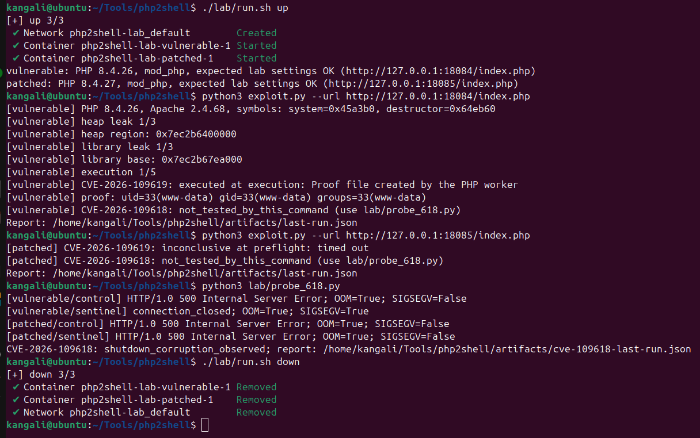

# PHP2Shell: local evidence and PHP release checks

This repository separates three tasks. `exploit.py` reproduces the **session
upload-progress path for CVE-2026-109619** on a pair of pinned Apache images.
`lab/probe_618.py` tests **shutdown corruption for CVE-2026-109618** with four
isolated local cases. `audit.py` reads the PHP version from an operator's
inventory or an operator-owned HTTP endpoint, then compares it with upstream
fixed releases for **CVE-2026-109618 and CVE-2026-109619**. A version check
sends no CVE payload and does not prove that a site is exploitable.

| Claim | Evidence status in this repository |
| --- | --- |
| CVE-2026-109619, session-state path on pinned PHP 8.4.26 mod_php | Demonstrated locally: the proof command ran as `www-data` |
| CVE-2026-109619 on other versions, builds, SAPIs, or sites | Not tested |
| CVE-2026-109618, shutdown corruption on pinned PHP 8.4.26 mod_php | Observed locally: OOM followed by SIGSEGV in `zend_array_destroy()` during `php_request_shutdown()`; RCE was not tested |
| Upstream release versions affected by the two advisories | Can be checked passively with `audit.py` |

## Why these two CVEs require different evidence

[CVE-2026-109618](https://github.com/php/php-src/security/advisories/GHSA-w8hw-w9fx-j79w)
concerns OOM interrupting an operation after request data has become
reachable but before it is fully initialized. When shutdown reads the invalid
data, corruption can occur **within that request**. The local probe compares
a control value, a sentinel value, and a fixed build; the backtrace places
the crash after OOM on the shutdown path. PHP source and the
[Red Hat technical report](https://bugzilla.redhat.com/show_bug.cgi?id=CVE-2026-109618)
support the connection to a HashTable entry published before allocation of
its key has completed. This test shows corruption resulting in a crash
controlled by input variation, **not RCE for this CVE**.

[CVE-2026-109619](https://github.com/php/php-src/security/advisories/GHSA-6wmf-4rv5-p3rp)
concerns global state that still points to memory owned by a previous
request. After that memory is freed, **the next request on the same worker**
consumes the state before normal initialization clears it. The path
demonstrated here uses session upload-progress; OOM triggers an interruption
on that path, but is not automatically evidence for CVE-2026-109618.

Both PHP advisories describe the possibility of unauthenticated RCE under
certain conditions. This does not mean that every installation with an older
version number is exploitable with a single payload: SAPI, configuration,
vendor patches, frontend, extensions, allocator, and build layout affect the
path and outcome.

## Upstream versions

| PHP branch | Range before the fix | Fixed release |
| --- | --- | --- |
| 8.2 | < 8.2.35 | 8.2.35 |
| 8.3 | < 8.3.36 | 8.3.36 |
| 8.4 | < 8.4.27 | 8.4.27 |
| 8.5 | < 8.5.12 | 8.5.12 |

This table follows both upstream advisories, not every distribution's patch
inventory. Versions below the thresholds may receive vendor backports. PHP
8.1 and older are outside these four branch ranges; check their distribution
support and patches separately. A version number sent over HTTP may also be
hidden, incorrect, or unrepresentative of all workers.

## Checking your own site or lab

Standard Python 3 is sufficient for `audit.py`; Docker is not required. If
the operator knows the version of the package actually running:

```bash
python3 audit.py --php-version 8.4.26
```

For a web endpoint that exposes its PHP version, the script sends **one
ordinary GET** and reads either the `X-Powered-By: PHP/...` header or the JSON
field `php_version`. The built-in lab endpoint provides that JSON field:

```bash
python3 audit.py --url http://127.0.0.1:18084/index.php
```

A site that hides its version produces `unknown`. A response may contain an
untrusted version claim; use package inventory or administrator information
to make remediation decisions. `upstream_affected_range` means the version
is below the upstream fixed release; `upstream_fixed_range` means it is at or
above that release; `unknown` means it cannot be classified. All results have
`exploitability: not_tested`. The script does not follow redirects, accept
credentials in the URL, read more than 64 KiB of response data, or perform a
POST, OOM, crash, or command execution.

If the result indicates an affected range, verify the build and vendor
patches, ensure all workers are using the new package, and prioritize the
update. According to the [PHP announcement](https://www.php.net/archive/2026.php#2026-10-21-5),
updating is the complete mitigation for both issues.

## Reproducing both CVEs in the built-in lab

Docker Engine, Docker Compose, and Python 3 are required. Two official PHP
images are pinned by digest in [`compose.yaml`](./compose.yaml). Ports are
published only to `127.0.0.1`: 18084 for PHP 8.4.26 and 18085 for PHP 8.4.27.
The containers use Apache/mod_php prefork, one worker, `memory_limit=8M`,
`post_max_size=32M`, and enabled session upload-progress. This configuration
is intended for reproduction; do not expose the vulnerable image as a public
service.

For a demonstration from the host, start the lab and point the Python script
directly at each target's loopback URL. The CVE-2026-109618 path is tested
separately:

```bash
./lab/run.sh up
python3 exploit.py --url http://127.0.0.1:18084/index.php
python3 exploit.py --url http://127.0.0.1:18085/index.php
python3 lab/probe_618.py
./lab/run.sh down
```

<p align="center">
  
</p>

Alternatively, `./lab/run.sh all` runs both demonstrations with their
controls after `up`. `./lab/run.sh compare` runs only CVE-2026-109619;
`./lab/run.sh probe-618` runs only CVE-2026-109618. The older forms
`python3 exploit.py vulnerable`, `patched`, and `compare` remain available.
`exploit.py --url` accepts only the two exact loopback addresses above; other
URLs are rejected before any request is sent. Docker provides the targets,
while both Python scripts run on the host.

`compare` runs [`exploit.py`](./exploit.py) against both containers with the
same request sequence and, by default, at most three attempts per stage. The
proof command is fixed at `id>/out/p1`; the container's result file appears
at `artifacts/vulnerable/p1` or `artifacts/patched/p1`, and structured results
are written to [`artifacts/last-run.json`](./artifacts/last-run.json). Each run
overwrites that JSON file; use `compare` to record the results for both
targets together. Each target has two claim entries: the result of the
CVE-2026-109619 attempt and `not_tested_by_this_command` for CVE-2026-109618.
You can also run one side with `./lab/run.sh vulnerable` or
`./lab/run.sh patched`. The `down` command stops the containers but keeps the
artifacts.

In a single-target demonstration, the process exits with code `0` only if
execution evidence is visible. Therefore, the `--url` command against the
patched side normally exits with code `1` and reports `not_observed`; this is
the expected control result, not proof that every CVE variant is safe. The
`compare` mode exits with code `0` if the vulnerable side produces evidence
and the patched side does not produce evidence in those attempts.

The script obtains symbol offsets from the `libphp.so` running inside the
container and checks the Apache version. The available memory-layout profile
covers only Apache 2.4.68 on the pinned image. The `--url` option selects a
lab endpoint; it does not make the chain portable to external URLs or other
builds. Changing only the port or URL is insufficient to make the RCE chain
work on another lab.

An `executed` result means a fresh proof file containing the worker's identity
appeared on that build. `not_observed` means a required stage was not observed
within the limited attempts; it is not a finding that the target is safe.
`inconclusive` means a preliminary check, configuration, or execution failed
before a conclusion could be reached. Comparison with a patched build helps
test the specific claim, but does not rule out all CVE variants on every
installation.

### Independent CVE-2026-109618 test

[`lab/probe_618.py`](./lab/probe_618.py) uses `docker run` to create four
temporary containers from the same two image digests. Each uses
[`lab/oom.ini`](./lab/oom.ini) (`memory_limit=32M`, `post_max_size=8M`), one
worker, and a random loopback port. Each variation starts from a clean
container: control and sentinel on PHP 8.4.26, followed by control and
sentinel on PHP 8.4.27. The script does not accept other target URLs, removes
the containers after each case, and does not attempt command execution.

A `shutdown_corruption_observed` result requires OOM in all four cases,
SIGSEGV only in the vulnerable build's sentinel variation, and no SIGSEGV in
the vulnerable control or either patched case. Results are saved in
[`artifacts/cve-109618-last-run.json`](./artifacts/cve-109618-last-run.json).
The [lab backtrace](./artifacts/cve-109618-backtrace.txt) shows SIGSEGV in
`zend_array_destroy()` through `php_request_shutdown()`. This is evidence of
memory corruption and a resulting crash for the tested profile; this
repository contains no evidence of RCE for CVE-2026-109618. If any control
does not match, the script returns `inconclusive` instead of treating the CVE
as demonstrated.

## Evidence limits and remaining work

Records of tests already run are in [`EVIDENCE.md`](./EVIDENCE.md). On PHP
8.4.26, the session-state chain produced execution evidence as `www-data`.
On PHP 8.4.27, the required heap leak was not observed in three attempts. The
separate CVE-2026-109618 probe produced a shutdown crash only for the
vulnerable build's sentinel variation. That evidence does not yet show
command execution for CVE-2026-109618. Reproduction on other SAPIs, versions,
and builds has also not been tested.

## References

- [PHP advisory for CVE-2026-109618](https://github.com/php/php-src/security/advisories/GHSA-w8hw-w9fx-j79w)
- [PHP advisory for CVE-2026-109619](https://github.com/php/php-src/security/advisories/GHSA-6wmf-4rv5-p3rp)
- [Red Hat technical report for CVE-2026-109618](https://bugzilla.redhat.com/show_bug.cgi?id=CVE-2026-109618)
- [PHP security announcement](https://www.php.net/archive/2026.php#2026-10-21-5)
- [Wiz analysis](https://www.wiz.io/blog/php2shell-php-rce)
- [eness research repository](https://github.com/eness/php2shell-CVE-2026-109618-CVE-2026-109619-PoC)
